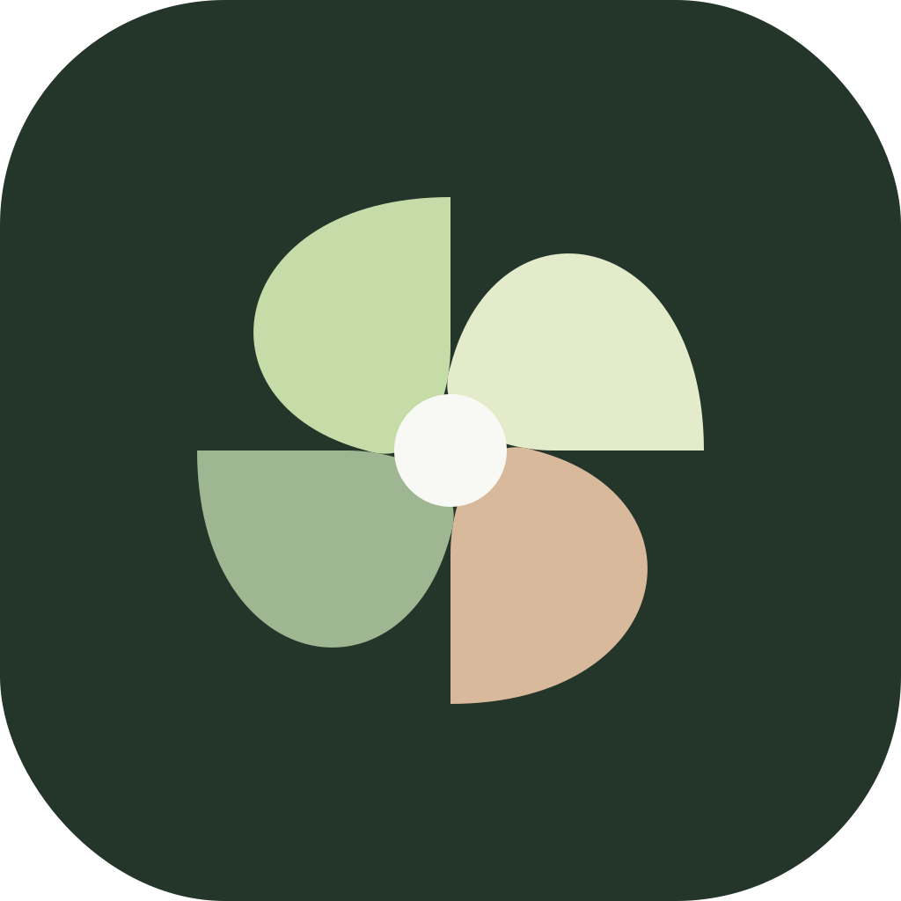

<p align="center"></p>

# curdr

**Less in your head. More shipped.** An open-source AI co-founder for solo founders, powered by [Hermes](https://github.com/NousResearch/hermes-agent).

Say everything on your mind. Review a smaller plan, park distractions and start the work that matters. Your agent challenges weak assumptions, remembers the context you choose to keep, and interrupts only for useful results or decisions.

[Website](https://curdr-founders.codingpenguin.chatgpt.site) · [Releases / Android](https://github.com/DasWeltall/curdr/releases) · [Agent install guide](install.md)

## Install

**Already have Hermes?** Send it this:

> Install or update curdr using https://raw.githubusercontent.com/DasWeltall/curdr/main/install.md. Preserve my profile, data and permissions. Use minimal tokens and no paid model tests.

**New to Hermes?** On your Linux, macOS or WSL2 server:

```bash
curl -fsSL https://raw.githubusercontent.com/DasWeltall/curdr/main/scripts/bootstrap.sh -o /tmp/curdr-install.sh && bash /tmp/curdr-install.sh
```

The installer installs Hermes if missing, opens its provider setup, verifies a pinned curdr release and starts your curdr server. Your provider login/API key is still required. It keeps an existing Hermes installation. Review the [script](scripts/bootstrap.sh) before running it. Add `--voice` to install local transcription (FFmpeg required).

Open your server's curdr URL, choose **Connect Hermes**, enter that URL and the pairing code generated on the host with `.venv-curdr/bin/curdr-gateway pair`. [Phone access and HTTPS](docs/SELF-HOST.md) are required for browser camera/microphone. A localhost URL only works on the server itself.

- **Android:** install the APK from Releases, or use the web app.
- **iPhone:** open your server URL in Safari → Share → Add to Home Screen → Open as Web App.
- **Desktop:** use the same URL in a browser.

## What you get

- Voice/text brain dumps with one-step transcription and planning. **Start**, **Save for later** or **Park**; captures are not commitments.
- Main chat and agent-created channels with separate context, real Hermes streaming and tool activity.
- Explicit approvals, including session/rule permission only when Hermes allows it.
- Reviewable tasks, editable routines, files and compact interactive visualizations.
- Founder interview, editable memory and a quiet co-founder skill. Useful answers, not a long answer split into many bubbles.
- Android notification delivery code with quiet hours and sleep. **Requires your FCM/Expo build credentials and gateway opt-in**; it does not work in Expo Go. [Setup](docs/NOTIFICATIONS.md).

This is an early release. Your models, tools and permissions come from your Hermes. Native iOS distribution and web push are not provided. No fake tool results or unsupported terminal commands.

## Develop

Python 3.11+, Node 24+, npm, Git and a configured Hermes API:

```bash
git clone https://github.com/DasWeltall/curdr.git
cd curdr
bash scripts/install-local.sh --hermes-env "$HOME/.hermes/.env"
.venv-curdr/bin/curdr-gateway serve
```

App development: `npm ci` then `npm run go` (Expo Go) or `npm run web`. Remote push needs a custom Android build. Checks: `npm run typecheck`, `npm test`, `python -m pytest backend/tests` (install `pytest pytest-asyncio` in a development environment).

## Contribute

Start with [CONTRIBUTING.md](CONTRIBUTING.md) or report the exact step where setup or a real founder workflow breaks. The most useful feedback: Did a brain dump reduce your workload? Was an interruption worth it? Could you get connected without help? [What to test next](docs/product/COMMUNITY-VALIDATION.md).

[Connection details](docs/CONNECT-HERMES.md) · [Self-hosting](docs/SELF-HOST.md) · [Website architecture](docs/WEBSITE.md) · [Security](SECURITY.md) · [MIT license](LICENSE)

Avatar Studio components retain their original MIT attribution in [third_party/avatar-studio/LICENSE](third_party/avatar-studio/LICENSE).
