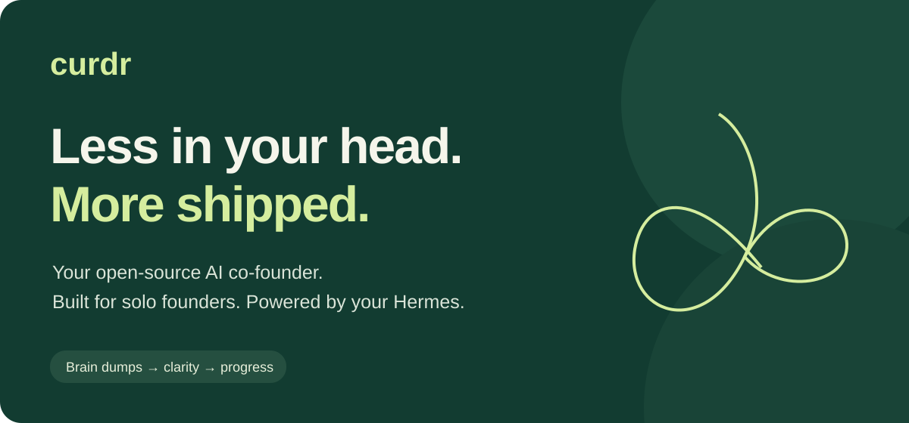

<p align="center"></p>

An open-source AI co-founder for solo founders, powered by [Hermes](https://github.com/NousResearch/hermes-agent).

Capture thoughts by voice or text. Turn brain dumps into focused plans, start tasks and review the results. Includes separate channels, routines, approvals and interactive visualizations. Your workspace stays on your server.

## Install

Give your Hermes this [installation guide](https://raw.githubusercontent.com/DasWeltall/curdr/main/install.md).

Or install on a Linux, macOS or WSL2 server:

```bash
curl -fsSL https://raw.githubusercontent.com/DasWeltall/curdr/main/scripts/bootstrap.sh -o /tmp/curdr-install.sh
bash /tmp/curdr-install.sh
```

Open your server’s curdr URL and pair using the code printed on the host. Use the web interface on any phone or computer. On iPhone, add it to your Home Screen. Android users can also install the APK from [Releases](https://github.com/DasWeltall/curdr/releases).

Requires Python 3.11+, Node 24+, Git and model access. Voice uses the speech provider configured in your Hermes profile and needs FFmpeg on that host. See [connection setup](docs/CONNECT-HERMES.md) and [notification setup](docs/NOTIFICATIONS.md).

## How it works

curdr runs alongside Hermes. Its gateway serves the web interface and stores conversations, settings, files and tasks. Hermes runs the agent and its tools. Model credentials stay on the host. New browsers pair once; external actions follow the configured approval rules.

## Contribute

See [CONTRIBUTING.md](CONTRIBUTING.md), [API](docs/api.md), [Security](SECURITY.md) and [MIT license](LICENSE). Avatar components retain their [upstream attribution](third_party/avatar-studio/LICENSE).
